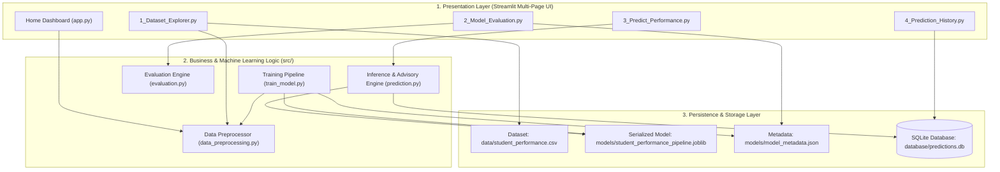
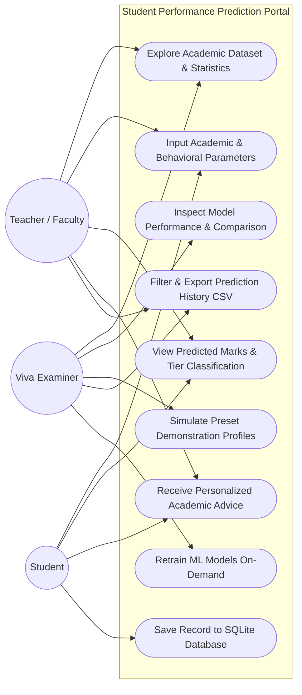
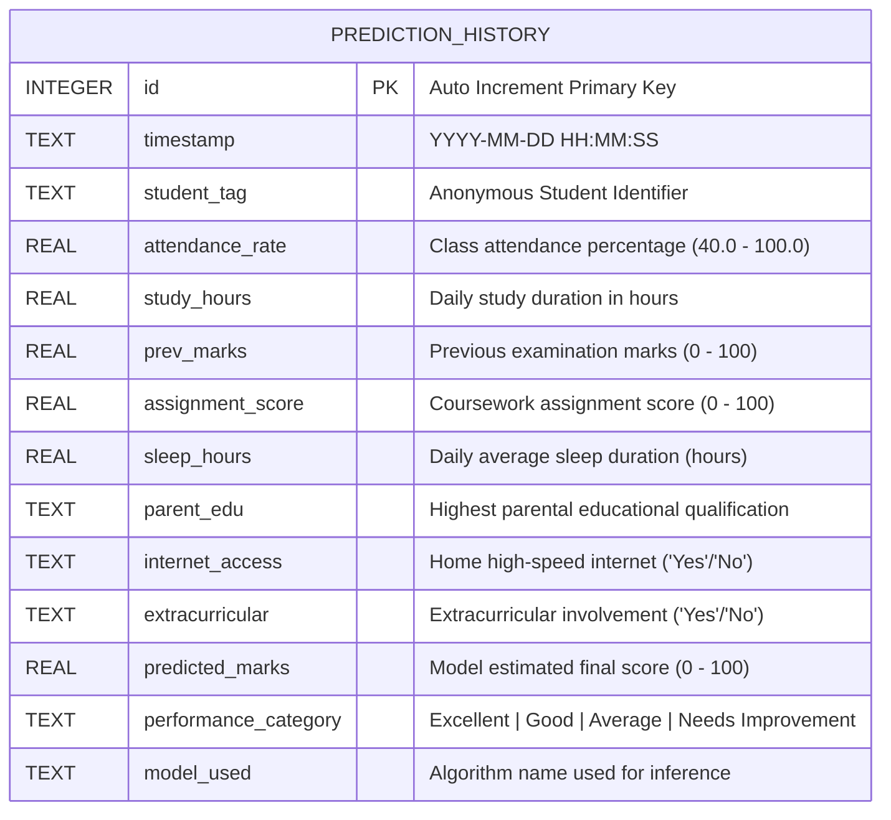

# System Architecture & Technical Specifications
## Student Performance Prediction Using Machine Learning
**Academic Year:** 2026 | **Degree:** Bachelor of Technology (B.Tech) in Computer Science & Engineering

---

## 1. High-Level Architectural Overview

The system is designed following a **Modular 3-Tier Layered Architecture** separating the interactive Presentation Layer, the Core Machine Learning & Business Logic Layer, and the Data Persistence Layer.



---

## 2. Machine Learning Pipeline Architecture

The training system integrates Scikit-learn's `Pipeline` and `ColumnTransformer` to guarantee zero data leakage between feature scaling and estimator training.

```mermaid
flowchart LR
    subgraph Input_Stage["Data Ingestion"]
        RAW["Raw Academic CSV"] --> VAL["Schema & Range Validation"]
        VAL --> IMP["Median & Mode Imputation"]
        IMP --> SPLIT["80/20 Train-Test Split"]
    end

    subgraph Transformation_Stage["ColumnTransformer"]
        SPLIT --> NUM["Numerical Features (5)"]
        SPLIT --> CAT["Categorical Features (3)"]
        NUM --> SCALER["StandardScaler (Z-Score Normalization)"]
        CAT --> ENCODER["OneHotEncoder (handle_unknown='ignore')"]
        SCALER --> FEAT_UNION["Feature Union Matrix"]
        ENCODER --> FEAT_UNION
    end

    subgraph Modeling_Stage["Candidate Regressors"]
        FEAT_UNION --> LR["Linear Regression (Baseline)"]
        FEAT_UNION --> DT["Decision Tree Regressor"]
        FEAT_UNION --> RF["Random Forest Regressor"]
    end

    subgraph Selection_Stage["Model Selection & Export"]
        LR --> EVAL["Compute MAE, RMSE, R²"]
        DT --> EVAL
        RF --> EVAL
        EVAL --> BEST{"Select Winner: Highest R² & Lowest RMSE"}
        BEST --> EXPORT["joblib.dump() -> pipeline.joblib + metadata.json"]
    end
```



---

## 3. Data Flow Diagrams (DFD)

### 3.1 DFD Level 0 (Context Diagram)

```mermaid
flowchart TD
    User(["Student / Faculty / Viva Examiner"])
    System[["Student Performance Prediction System"]]
    DB[("Local Storage & SQLite DB")]

    User -- "1. Enter academic indicators (Attendance, Study hours, etc.)" --> System
    User -- "2. Upload/inspect dataset or request EDA" --> System
    System -- "3. Return predicted marks (0-100), tier, & guidance" --> User
    System -- "4. Render charts, residual plots & model benchmarks" --> User
    System <--> "5. Read/Write historical inference logs" DB
```

### 3.2 DFD Level 1 (Process Breakdown)

```mermaid
flowchart TD
    E1(["User / Student"])
    P1["Process 1.0: Dataset Ingestion & EDA"]
    P2["Process 2.0: Model Training & Evaluation"]
    P3["Process 3.0: Input Feature Validation"]
    P4["Process 4.0: Machine Learning Inference"]
    P5["Process 5.0: Academic Feedback Generation"]
    P6["Process 6.0: Audit Logging & Database Export"]

    D1[("student_performance.csv")]
    D2[("pipeline.joblib")]
    D3[("predictions.db")]

    E1 -->|Requests EDA| P1
    D1 --> P1
    P1 -->|Visualizations & Summary| E1

    D1 --> P2
    P2 -->|Saves best pipeline| D2
    P2 -->|Benchmark metrics| E1

    E1 -->|Submits Parameters| P3
    P3 -->|Validated Vector| P4
    D2 -->|Pipeline weights| P4
    P4 -->|Predicted Score (0-100)| P5
    P5 -->|Score Gauge, Category & Advice| E1

    P4 -->|Prediction details| P6
    P6 <-->|CRUD Operations| D3
    D3 -->|Export History CSV| E1
```

---

## 4. Use Case Diagram



---

## 5. SQLite Entity-Relationship (ER) Schema



---

## 6. Security, Privacy & Ethical Guardrails

1. **Anonymous Identity Protection:** No personally identifiable information (PII) such as student full names, contact numbers, email addresses, or government IDs are required or recorded.
2. **Deterministic Reproducibility:** Data split and pipeline components are seeded (`random_state=42`) ensuring zero drift across demonstrations.
3. **Transparent Model Limitations:** Non-deterministic disclaimers are visibly displayed across both the web interface and generated export summaries.
